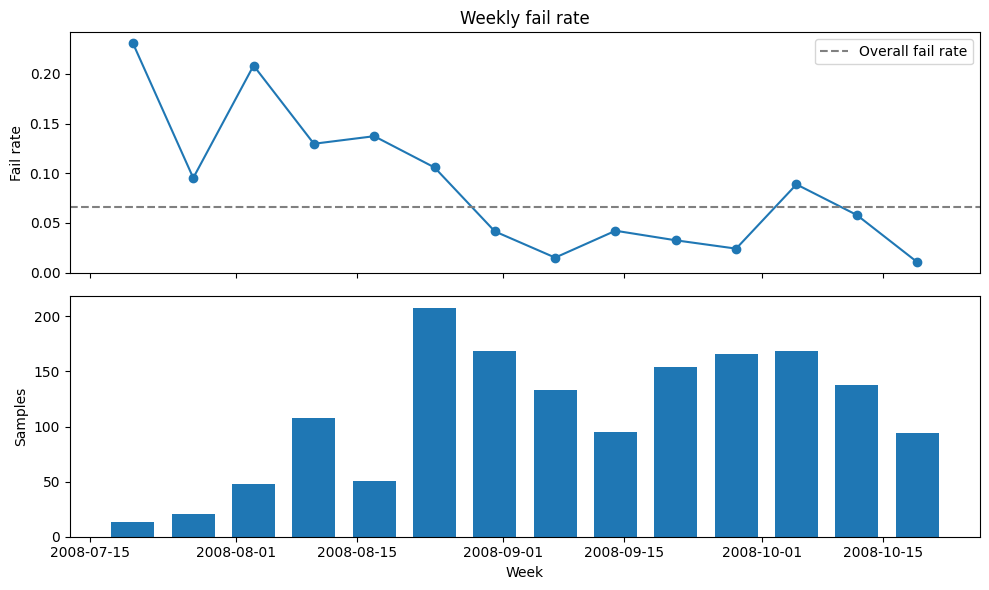
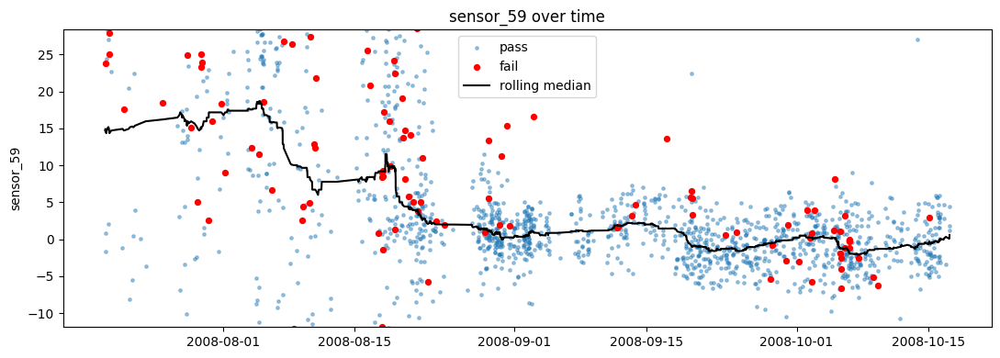
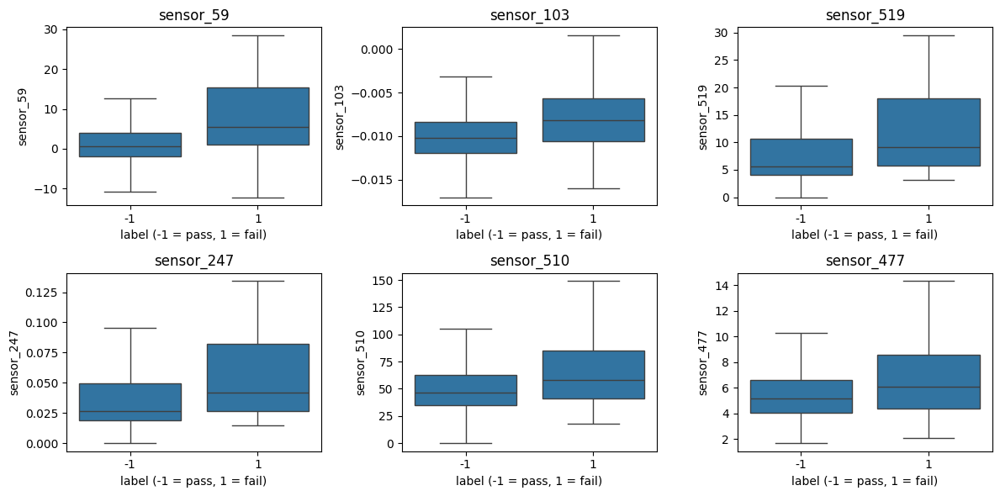

# SECOM process analysis

I used the UCI SECOM dataset (semiconductor manufacturing, 1,567 samples, 590 sensors, 104 failures)
to find out which sensors are linked to failed products, and whether a model can warn early.

## What I found
- The fail rate dropped from 12.9% to 4.1% around late August. The reason is not in the data.
- Many sensors looked linked to failure, but most of it was time drift. After removing the drift,
  only sensor_59, 477 and 205 stayed clearly significant, and the signal is weak (AUC about 0.61).
- A random train/test split overstates the model. A model that only knows the date gets a ROC-AUC of 0.63.
  With time-ordered validation, logistic regression gets about 0.59.
- Flagging the 10% highest-risk samples catches about 18% of failures (random: 10%), with many false alarms.

## Limits
Only 104 failures in total, and 6 to 22 per test fold, so every number is noisy. The sensors are anonymous,
so I can't say what they measure. I don't know what changed in the process in August.

## Notebooks
1. `notebooks/01_load_and_inspect.ipynb`: load the data, drop constant and mostly-missing sensors
2. `notebooks/02_eda.ipynb`: fail rate over time, sensor screening, time drift
3. `notebooks/03_modeling.ipynb`: baseline models, time-ordered validation

## Data
UCI Machine Learning Repository, SECOM: https://archive.ics.uci.edu/dataset/179/secom (CC BY 4.0)
